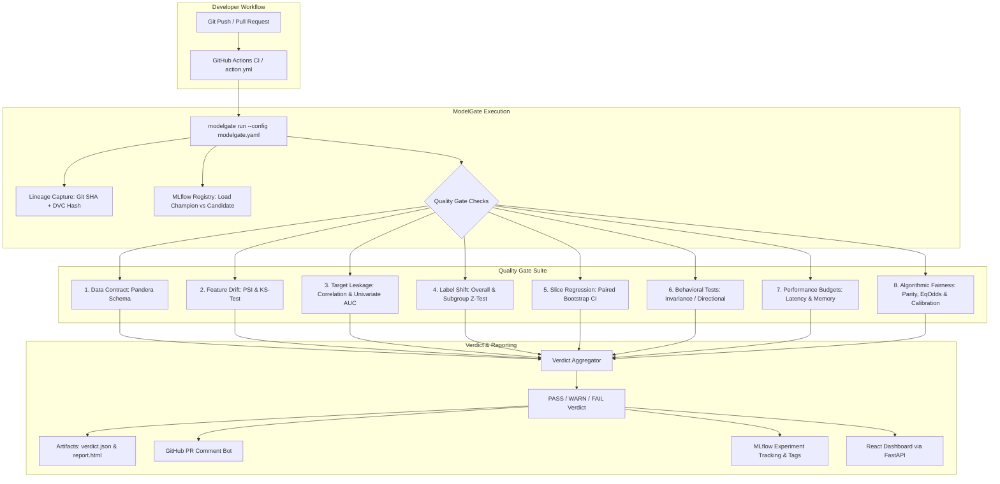

# ModelGate

[](https://github.com/your-org/ModelGate/actions/workflows/ci.yml)
[](https://opensource.org/licenses/MIT)
[](https://www.python.org/downloads/)
[](https://github.com/your-org/ModelGate)

**ModelGate** is an open-source CI/CD quality gate for machine learning models that intercepts pull requests changing model code, hyperparameters, or training data. Acting as automated code review and unit testing for ML, it runs a battery of **eight** statistical and operational checks—data contracts, feature drift, target leakage, subgroup label shift, slice regressions with vectorized paired bootstrap confidence intervals, behavioral invariance, performance budgets, and algorithmic fairness—blocking regressions before they reach production.

---

## Real Output & Dashboard

### 1. GitHub PR Comment Bot (`modelgate_output/pr_comment.md`)
When executed on a pull request, `modelgate run` writes `modelgate_output/pr_comment.md` (via `build_pr_comment` in `src/modelgate/report.py`):

```markdown
## ModelGate verdict: PASS

**Candidate** `df94431` | seed 42 | data `4d4bede1...`

| Check | Status | Summary |
|---|---|---|
| Data Contract | ✅ PASS | 0 violations |
| Drift | ✅ PASS | Max PSI 0.02, no significant drift |
| Leakage | ✅ PASS | Max \|r\| 0.12, max single-feature AUC 0.64 |
| Label Shift | ✅ PASS | Max label rate shift 0.04 (overall 0.01) |
| Slices | ✅ PASS | No slice regression detected (overall f1: 0.879) |
| Behavioral | ✅ PASS | flip rate 0.0% |
| Budgets | ✅ PASS | p50 15.52ms (0.97x [95% CI 0.94x-1.00x] vs champion 16.07ms), size 0.1MB, mem 0.1MB |
| Fairness | ✅ PASS | demographic_parity_diff 0.00, eq_odds 0.00, cal_gap 0.00 |
```

---

### 2. React Dashboard (`http://localhost:3000`)
The Vite + React dashboard (`dashboard/src/`) queries the FastAPI backend (`http://localhost:8000`) and exposes five views:
- **Runs (`/`) & Run Detail (`/runs/:id`)**: Run list with status/branch filtering, per-check verdicts, slice bootstrap CI breakdown, and run approval controls.
- **Models (`/models`)**: Registered model runs and active champion indicator.
- **Compare (`/compare`)**: Side-by-side metric comparison (`GET /compare?a=<id>&b=<id>`).
- **Benchmark (`/benchmark`)**: Fault-injection benchmark summary loaded from `GET /bench`.
- **Settings (`/settings`)**: Project configuration and API token settings.

---

## Quickstart (3 Commands)

Get ModelGate running locally with the credit-risk demo in 3 commands:

```bash
# 1. Install ModelGate with development dependencies
pip install -e ".[dev]"

# 2. Train baseline model and generate demo datasets
python demo/train.py

# 3. Execute the full ModelGate quality check suite
modelgate run --config modelgate.yaml
```

*To launch the full API, MLflow, and Dashboard stack via Docker:*
```bash
docker compose up -d
```

---

## Architecture Diagram



---

## Benchmark

[`docs/benchmark.md`](docs/benchmark.md) is generated strictly from [`docs/benchmark_results.json`](docs/benchmark_results.json) (reproduced end-to-end via `python scripts/bench_public.py`, which downloads UCI Adult and German Credit from OpenML and runs both the 30-seed synthetic 7-fault benchmark and the 30-seed public fairness benchmark), including exact commands, commit hash, evaluated seeds, Wilson 95% confidence intervals, and no-op false-positive rates.

---

## Project Structure

```
ModelGate/
├── .github/
│   ├── CODEOWNERS                 # Code Owner rules protecting /champion/ and /champion.dvc
│   └── workflows/
│       ├── ci.yml                 # Lint (ruff), type check (mypy), tests (pytest), dashboard build
│       └── modelgate.yml          # Fail-closed quality gate on PRs (pinned base-branch install)
├── action.yml                     # Reusable GitHub Composite Action
├── docker-compose.yml             # Local multi-service stack (API, MLflow, Dashboard, Seed)
├── Dockerfile                     # Multi-stage container for ModelGate API & CLI
├── pyproject.toml                 # Package configuration, Hatchling build, pytest & ruff settings
├── modelgate.yaml                 # Quality gate configuration file
├── data.dvc                       # DVC lockfile tracking SHA-256 data hash
├── data/                          # Reference, train, and test datasets
├── demo/
│   ├── train.py                   # Credit-risk demo dataset generation & training
│   └── contracts/
│       └── schema.py              # Pandera data contract schema
├── dashboard/                     # React + Vite TypeScript Dashboard
│   ├── src/
│   │   ├── pages/                 # Runs, Models, Compare, Benchmark, Settings
│   │   └── App.tsx                # Main router & layout
│   ├── nginx.conf                 # Production reverse-proxy config
│   └── Dockerfile                 # Multi-stage Node/Nginx container
├── docs/
│   ├── architecture.md            # System design, data flow, and check mechanics
│   ├── usage.md                   # CLI commands, config schema, and CI/CD guide
│   ├── decisions.md               # Architecture Decision Records (ADRs)
│   ├── benchmark.md               # Fault-injection benchmark methodology & findings
│   └── benchmark_results.json     # Machine-readable 30-seed benchmark dataset
├── scripts/
│   ├── seed.py                    # Docker Compose seed script for initial demo data
│   ├── run_bench_fast.py          # Synthetic 30-seed benchmark runner
│   └── bench_public.py            # End-to-end OpenML (Adult, German Credit) + synthetic benchmark runner
├── src/modelgate/                 # Core Python package
│   ├── cli.py                     # Typer CLI (modelgate run / bench / reproduce / init)
│   ├── config.py                  # Pydantic models for modelgate.yaml
│   ├── verdict.py                 # Verdict aggregator (PASS / WARN / FAIL)
│   ├── stats.py                   # Paired bootstrap CI, PSI, KS-test, Holm-Bonferroni
│   ├── report.py                  # HTML report & GitHub Markdown PR comment generation
│   ├── registry.py                # MLflow model registry champion/challenger interface
│   ├── lineage.py                 # Git SHA & DVC data hash extraction
│   ├── loader.py                  # Dynamic module & object loader
│   ├── benchmark.py               # Benchmark fault generators & runner
│   ├── auth.py                    # Bearer token SHA-256 auth, RBAC, and audit logging
│   ├── api/                       # FastAPI backend
│   │   ├── main.py                # REST endpoints (/runs, /models, /settings, /audit, /users, /health)
│   │   └── models.py              # SQLModel & Pydantic database models
│   ├── checks/                    # Quality gate check modules (8 checks)
│   │   ├── data_contract.py       # 1. Pandera schema contract check
│   │   ├── drift.py               # 2. Feature PSI & KS-test drift check
│   │   ├── leakage.py             # 3. Target leakage check (|r| & univariate ROC-AUC)
│   │   ├── label_shift.py         # 4. Overall & subgroup label-shift check
│   │   ├── slices.py              # 5. Subgroup slice regression check with bootstrap CI
│   │   ├── behavioral.py          # 6. Invariance and directional metamorphic check
│   │   ├── budgets.py             # 7. Latency, model size, and peak memory check
│   │   └── fairness.py            # 8. Demographic parity, equalized odds & calibration check
│   └── integrations/
│       └── github/
│           └── pr_bot.py          # GitHub PR comment poster
└── tests/
    └── unit/                      # 110 unit tests across security, API, auth, CLI, checks, stats, registry, and reports
```

---

## Security & HTTPS Deployment

- **No Default Admin Token**: ModelGate never ships with a hardcoded or default admin token. Users are provisioned via `modelgate users add <name> --role <engineer|reviewer|admin>` (or bootstrapped via `MODELGATE_ADMIN_TOKEN` set explicitly at runtime), and only the SHA-256 hash of each bearer token is persisted in the database.
- **Role-Based Access Control & Audit Log**: Mutating endpoints enforce role checks (`engineer`, `reviewer`, `admin`) and log both allowed and denied (`401`/`403`/`400`) requests to the append-only `audit_log` table (`GET /audit`).
- **Restricted CORS**: Allowed origins default to `http://localhost:3000,http://localhost:5173` (configurable via `MODELGATE_CORS_ORIGINS`), with methods restricted to `GET, POST, PUT, OPTIONS` and headers restricted to `Authorization, Content-Type, Accept`.
- **HTTPS Requirement in Production**: Because bearer tokens are sent in the `Authorization: Bearer <token>` HTTP header, all non-localhost deployments **must** terminate TLS/HTTPS (e.g. behind Nginx, Caddy, Envoy, or a cloud load balancer with `https://` origins in `MODELGATE_CORS_ORIGINS`) so bearer tokens are never transmitted in cleartext.

---

## License

ModelGate is open-source software licensed under the [MIT License](LICENSE).
