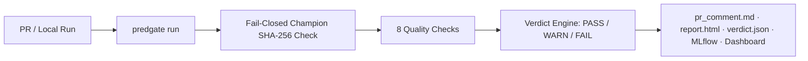

# PredGate

> **Renamed from `ModelGate` → `PredGate` (`predgate`)** because `modelgate` is already taken on PyPI. See [MIGRATION.md](MIGRATION.md) for the full package, import, CLI, config, and workflow migration guide.

[](https://github.com/taqi-stark/predgate/actions/workflows/ci.yml)
[](https://opensource.org/licenses/MIT)
[](https://www.python.org/downloads/)
[](docs/RELEASE_NOTES_v0.1.0-alpha.md)

**PredGate** is an open-source CI/CD quality gate for tabular machine learning models. On every pull request that changes model code, hyperparameters, or training data, it compares your candidate against the SHA-256-verified champion across **eight checks**—data contracts, feature drift, target leakage, subgroup label shift, paired-bootstrap slice regression, behavioral tests, interleaved latency/size/memory budgets, and relative algorithmic fairness—and posts an actionable `PASS` / `WARN` / `FAIL` report before bad models merge.

---

## Quickstart

Run PredGate locally on the included credit-risk demo (requires Python 3.10+; on Ubuntu/Debian install `git`, `python3-pip`, and `python3-venv` if not already present):

```bash
# 1. Clone and install PredGate inside a virtual environment
git clone https://github.com/taqi-stark/predgate.git
cd predgate
python3 -m venv .venv
source .venv/bin/activate
pip install -e ".[dev]"

# 2. Generate demo train/test/reference data
python demo/train.py

# 3. Verify setup and run all 8 checks (optionally pass --preset strict|balanced|quiet)
predgate doctor --config predgate.yaml
predgate run --config predgate.yaml
```

Inspect `predgate_output/pr_comment.md` and `predgate_output/report.html`, or start the full API + MLflow + React dashboard stack with `docker compose up -d`. See [`docs/usage.md`](docs/usage.md) for GitHub Actions setup and full config reference, or copy [`examples/minimal/`](examples/minimal/) into your own repo for a 5-minute standalone setup.

### What's Included in the PyPI Wheel vs. Dashboard (`predgate serve`)

- **Included in `pip install predgate` (the wheel)**: The `predgate` CLI (`run`, `doctor`, `init`, `baseline`, `users`, `compare`, `promote`, `reproduce`, `bench`, `serve`), all 8 check modules, report generators (`pr_comment.md`, `report.html`, `verdict.json`), MLflow/DVC lineage helpers, and the FastAPI REST backend started by `predgate serve` (API + Swagger docs at `http://localhost:8000/docs`).
- **Not included in the wheel**: The React + Vite web dashboard (`dashboard/`) is **not** packaged inside the PyPI wheel. To run the dashboard alongside the API, either:
  1. **Docker Compose** (recommended — starts API, MLflow, seeded demo runs, and dashboard at `http://localhost:3000`):
     ```bash
     docker compose up --build
     ```
  2. **Local Node.js (Node 20+)** from a git clone:
     ```bash
     predgate serve --port 8000 &
     cd dashboard && npm ci && npm run dev   # http://localhost:5173 (or npm run build)
     ```

---

## 60-Second Demo

<!-- TODO: replace with recorded 60-second demo GIF at docs/assets/demo.gif -->

> *GIF placeholder — drop your recorded 60-second walkthrough at `docs/assets/demo.gif` showing a PR triggering `Run PredGate`, the PR verdict comment, and the HTML/dashboard view.*

What happens in 60 seconds on a pull request:

1. **Verify champion integrity (fail-closed)**: GitHub Actions checks out `champion/model.pkl` from `origin/<base>` and verifies its pinned SHA-256 before running any PR code.
2. **Train candidate & run 8 checks**: `predgate run --config predgate.yaml` runs all statistical and operational checks with deterministic seeding.
3. **Post a high-signal PR comment** (including **Model family changed** and **Inconclusive Slices** banners when applicable):

```markdown
## PredGate verdict: WARN

**Candidate** `cf42bdc` | seed 42 | data `4d4bede1...`

> [!NOTE]
> **Model family changed:** Champion `GradientBoostingClassifier` → Candidate `RandomForestClassifier`. Algorithm swaps can shift single-row inference latency and subgroup selection rates even without data or label bugs.

| Check | Status | Summary |
|---|---|---|
| Data Contract | ✅ PASS | 0 violations |
| Drift | ✅ PASS | Max PSI 0.02, no significant drift |
| Leakage | ✅ PASS | Max \|r\| 0.12, max single-feature AUC 0.64 |
| Label Shift | ✅ PASS | Max label rate shift 0.02 (overall 0.01) |
| Slices | ⚠️ WARN | Inconclusive slices (1 slice(s) CI width > 0.10): region=West |
| Behavioral | ✅ PASS | flip rate 0.0% |
| Budgets | ✅ PASS | p50 15.52ms (0.97x [95% CI 0.94x-1.00x] vs champion 16.07ms), size 0.1MB, mem 0.1MB |
| Fairness | ✅ PASS | demographic_parity_diff 0.01, eq_odds 0.02, cal_gap 0.01 |

### ⚠️ Inconclusive Slices (Wide Confidence Intervals)

| Slice | N | Point Drop | 95% CI | CI Width | Limit |
|---|---|---|---|---|---|
| `region=West` | 93 | +0.018 | [-0.041, +0.077] | **0.118** | `0.10` |
```

4. **Review & promote**: Passing PRs merge normally; `FAIL` verdicts exit `1` and block merge; `WARN` verdicts highlight inconclusive slices, low-power MDE notes, or selection-rate shifts for human review in `report.html` or the React dashboard (`http://localhost:3000`).

---

## What It Catches / What It Doesn't

| Area | What PredGate Catches | What It Doesn't Catch / Known Limits |
|---|---|---|
| **Data Contracts** | Missing columns, wrong dtypes, nulls, and range/value violations defined in your Pandera schema (`data_contract.py`). | Semantic business rules or cross-table invariants you have not encoded in the schema. |
| **Feature Drift** | Marginal distribution shifts on shared features (reference-quantile PSI + KS), silent null-to-zero / sentinel value spikes (point-mass shift), and newly added columns (`new feature, no reference`, `info` or `warn`). | Pure multivariate / feature-interaction drift where every marginal distribution stays stable. |
| **Target Leakage** | Univariate linear (`|r|`) or rank (`single-feature ROC-AUC`) target leakage in training features. | Multi-feature composite leakage or subtle temporal lookahead with weak univariate signal (`|r| < 0.50` and `AUC < 0.85` under `balanced`). |
| **Label Shift** | Overall and per-subgroup label-rate shifts (`P(Y)` and `P(Y \| S=s)`) between reference and training snapshots via Holm-Bonferroni two-proportion z-tests. | Unlabeled production concept drift after deployment (no ground-truth labels). |
| **Slice Regressions** | Statistically confident subgroup metric drops (`ci_lower > max_drop` → `FAIL`; point drop `> max_drop` → `WARN`) and underpowered wide intervals (`ci_width > max_ci_width` → prominent `inconclusive` banner, `WARN` by default via `slices.on_inconclusive`). | Small 3–5 pt drops on tiny evaluation slices (e.g., `n < 150`); wide CIs cannot clear `ci_lower > 0.03` — see [`docs/power.md`](docs/power.md) for exact minimum rows per group. |
| **Behavioral Tests** | Invariance violations (e.g., predictions flipping when `applicant_id` changes) and directional monotonicity violations configured in `predgate.yaml`. | Domain invariants or adversarial edge cases not declared in `checks.behavioral`. |
| **Performance Budgets** | Single-row inference latency regressions via interleaved batched `median(cand) / median(champ)` paired bootstrap CI, serialized model size, and peak Python memory. | GPU/distributed batch-serving tail latency (p99 under load) or C++/external-service allocations outside Python `tracemalloc`. Intentional latency jumps during model-family swaps (e.g., GBDT → RF) will trigger `budgets` (accompanied by the `Model family changed` note). |
| **Algorithmic Fairness** | Relative widening of demographic parity, equal opportunity, equalized odds, and group calibration gaps vs. champion (`FAIL`/`WARN` via paired bootstrap CI), per-group selection-rate shifts (`WARN`), and low-power MDE notes. | Pre-existing champion unfairness (unless opt-in `enforce_absolute: true`), rare-event threshold shifts when base rate is ~0.2%, small-group shifts below 80%-power MDE, or intersectional groups not listed in `protected`. |
| **Scope & Serialization** | `sklearn`-compatible tabular binary classification models with fail-closed SHA-256 verified champion `pickle` baselines and CODEOWNERS governance. | Multi-class, regression, NLP, and vision models are only partially supported in `v0.1.0-alpha`; `skops`/ONNX serialization is not yet implemented. |

---

## Config Presets (`strict`, `balanced`, `quiet`)

Choose a preset in `predgate.yaml` (`preset: strict | balanced | quiet`) or via `predgate run --preset <name>`. Default thresholds are **unchanged** and match `balanced` exactly. Measured on **30 fresh seeds (`11000..11029`) × 5 datasets × 9 benign changes (`1,350` trials/preset)** via `scripts/bench_presets.py` ([`docs/preset_benchmark_results.json`](docs/preset_benchmark_results.json)):

| Preset | Quality FAIL (95% CI) | Quality WARN-Only (95% CI) | Latency FAIL (`budgets`) | Combined FAIL | Non-Swap Quality FAIL (N=1,050) | Best For |
|---|---|---|---|---|---|---|
| **`strict`** | 83/1350 (**6.1%**, [5.0%, 7.6%]) | 725/1350 (**53.7%**, [51.0%, 56.3%]) | 161/1350 (**11.9%**) | **15.2%** | 14/1050 (**1.3%**) | High-stakes / regulated models needing tight 2-pt slice bounds and new-feature warnings |
| **`balanced`** *(default)* | 49/1350 (**3.6%**, [2.8%, 4.8%]) | 247/1350 (**18.3%**, [16.3%, 20.4%]) | 135/1350 (**10.0%**) | **12.1%** | 5/1050 (**0.5%**) | General production CI — low non-swap false blocks, `slices.on_inconclusive: warn` |
| **`quiet`** | 25/1350 (**1.9%**, [1.3%, 2.7%]) | 99/1350 (**7.3%**, [6.1%, 8.8%]) | 59/1350 (**4.4%**) | **6.0%** | 1/1050 (**0.1%**) | High-velocity teams / small test sets (`slices.on_inconclusive: info`, wider margins) |

See [`docs/usage.md`](docs/usage.md#4-config-presets-strict-balanced-quiet) for the full preset threshold matrix.

---

## Honest Benchmark Summary

> **Dataset-Use Disclosure**: **All five benchmark datasets** (**UCI Adult**, **German Credit**, **Synthetic Credit**, **Bank Marketing**, and **COMPAS**) **were used during development**. Bank Marketing and COMPAS were initially run as held-out datasets at commit `8467d37`, then inspected to diagnose `slices.py` CI-bound and `drift.py` quantile-PSI/point-mass defects, and re-evaluated on fresh seeds (`9000..9029`) with frozen thresholds and zero post-hoc tuning. None of the five datasets should be treated as an unseen held-out benchmark.

All numbers below are generated strictly from [`docs/benchmark_results.json`](docs/benchmark_results.json) (frozen defaults at release code commit `f40f0e7`, fresh seeds `13000..13029`, 30 seeds per scenario; full tables, exact Evidently `0.7.23` configuration, and reproduction commands in [`docs/benchmark.md`](docs/benchmark.md)):

| Suite (`13000..13029`) | PredGate Result (95% Wilson CI) | Honest Tradeoffs & Comparator Highlights |
|---|---|---|
| **Synthetic 7-Fault** | **30/30 (100.0%)** FAIL on all 6 faults (`feature_leakage`, `label_shift`, `degraded_slice`, `schema_drift`, `latency_regression`, `fairness_regression`); **0/30 (0.0% FP, [0.0%, 11.4%])** on `noop` | Evidently `0.7.23` defaults had **11/30 (36.7% FP)** on `noop`; Overall Accuracy (`\|Δacc\|>1%`) missed `degraded_slice` (`0/30`) and `latency_regression` (`0/30`). |
| **Benign-Change Control** *(9 harmless retrains × 5 datasets = 1,350 trials)* | **Quality FAIL**: **56/1350 (4.1%)** (`~0.5%` excluding algo swaps); **Quality WARN-Only**: **234/1350 (17.3%)**; **Latency FAIL (`budgets`)**: **139/1350 (10.3%)** (all on `algo_swap_rf`); **Combined FAIL**: **168/1350 (12.4%)** | `drift`, `leakage`, and `label_shift` had **0/1350 (0.0%)** benign FAILs/WARNs. Benign model-family swaps (`GBDT → RF/LogReg`) legitimately shift latency and subgroup selection rates, driving most alerts. Evidently `0.7.23` defaults flagged **382/1350 (28.3%)**. |
| **All-5-Dataset Faults** *(30 seeds/fault)* | **30/30 (100%) FAIL** on `silent_null_imputation`, `fairness_proxy_feature`, and `fairness_regression` across all 5 datasets; **0/30 (0.0% FP)** `noop` FAIL **and** Flagged on all 5 datasets | **Where PredGate is weak**: small-cohort German Credit (`N_test=300`, `min_n=93`) caught `cohort_feature_corruption` only **8/30 (26.7%) FAIL / 13/30 (43.3%) Flagged** (vs. Per-Group Acc `26/30`); Synthetic rare-event `τ=0.75` threshold shift (~0.2% positive rate) was **0/30**; group threshold shifts that narrow DP (`τ=0.25`) trigger mostly `WARN` (Adult `3/30` FAIL / `30/30` Flagged, Bank `13/30` FAIL / `29/30` Flagged). See [`docs/power.md`](docs/power.md). |

---

## Architecture



## Security & Privacy Highlights

- **Zero Telemetry**: PredGate collects **no telemetry** — it never sends analytics, crash reports, model metrics, or usage pings to any external server.
- **Fail-closed champion verification**: `.github/workflows/predgate.yml` and `action.yml` install PredGate from the committed base branch (`git archive`) or an explicit pinned spec (never the untrusted PR head) and verify `champion/model.pkl` against the base-branch SHA-256.
- **No default admin token**: API users are provisioned explicitly (`predgate users add <name> --role <engineer|reviewer|admin>` or `PREDGATE_ADMIN_TOKEN`), with SHA-256 hashed bearer tokens, RBAC, restricted CORS, and an append-only `/audit` log. Always terminate TLS/HTTPS in non-localhost deployments. See [`SECURITY.md`](SECURITY.md).

## Documentation

- [`docs/usage.md`](docs/usage.md) — CLI reference (`predgate run`, `predgate doctor`), `predgate.yaml` schema, presets, GitHub Actions, Docker, and RBAC
- [`docs/power.md`](docs/power.md) — Statistical power formulas and minimum rows per group for 3-pt and 5-pt drops at 80% power
- [`docs/performance.md`](docs/performance.md) — Measured wall-clock runtime and memory for 1k, 10k, and 100k test rows
- [`docs/benchmark.md`](docs/benchmark.md) — Full benchmark tables, dataset-use disclosure, exact Evidently configuration, and reproduction steps
- [`docs/architecture.md`](docs/architecture.md) — System design and check mechanics
- [`docs/decisions.md`](docs/decisions.md) — Architecture Decision Records (ADRs)
- [`docs/RELEASING.md`](docs/RELEASING.md) — PyPI / TestPyPI Trusted Publishing (OIDC) setup and release workflow
- [`docs/RELEASE_NOTES_v0.1.0-alpha.md`](docs/RELEASE_NOTES_v0.1.0-alpha.md) — `v0.1.0-alpha` release notes and honest limitations table
- [`examples/minimal/`](examples/minimal/) & [`examples/github-workflow/`](examples/github-workflow/) — Copy-paste starter example and recommended GitHub workflow

## License

PredGate is open-source software licensed under the [MIT License](LICENSE).
