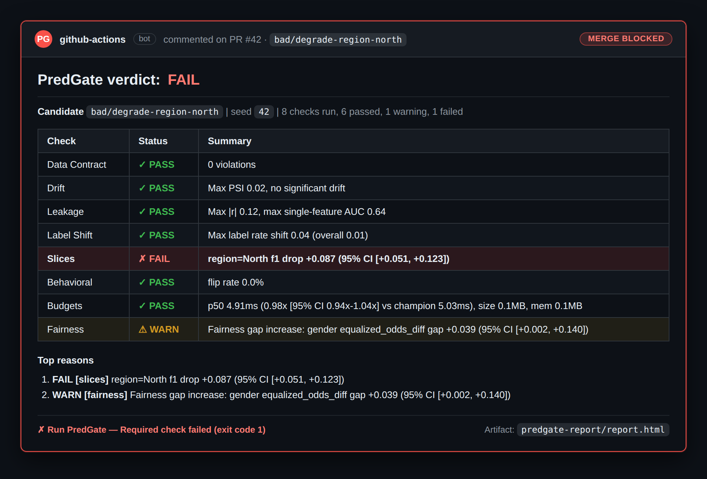
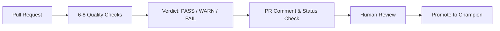
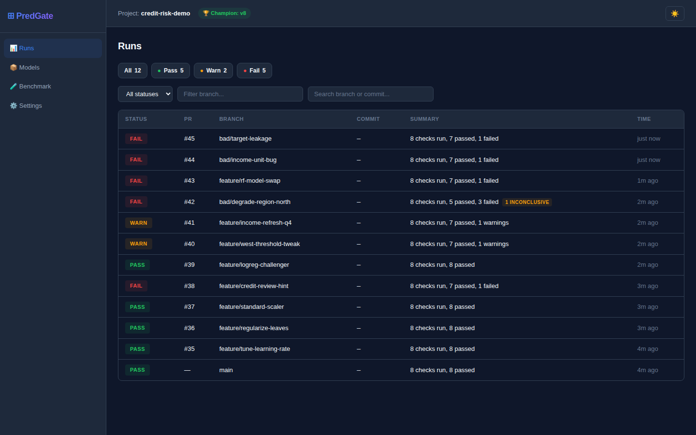

# PredGate

Open-source CI/CD quality gate that blocks broken tabular ML models before they merge.



## The problem

Overall accuracy hides broken models: a pull request can raise average F1 while silently degrading a minority region, leaking the target, inflating single-row latency, or widening a fairness gap.
Post-deployment monitors only alert after bad predictions have already reached users.
PredGate compares every candidate PR against your SHA-256-verified champion across eight automated checks before code merges.

## How it works in your workflow



1. **Open a pull request** changing model code, features, hyperparameters, or data.
2. **Verify the champion fail-closed** by loading `champion/model.pkl` from the base branch and checking its pinned SHA-256 before running PR code.
3. **Run six to eight checks** against the champion with deterministic seeding and paired bootstrap confidence intervals.
4. **Post the verdict to the PR** (`PASS`, `WARN`, or `FAIL` with exit code `1` on hard regressions, plus `report.html` and dashboard history).
5. **Review and promote** passing or approved models to `@champion` in MLflow.

## Quickstart

```bash
pip install predgate
predgate init my-gate && cd my-gate
python3 -c "import os, numpy as np, pandas as pd; os.makedirs('data', exist_ok=True); r = np.random.RandomState(42); df = pd.DataFrame({'x': r.randn(600), 'region': r.randint(0, 2, 600), 'age_bucket': r.randint(0, 2, 600), 'default': r.randint(0, 2, 600)}); df[:300].to_csv('data/train.csv', index=False); df[300:450].to_csv('data/test.csv', index=False); df[450:].to_csv('data/reference.csv', index=False)"
predgate run
```

Sample output (run `predgate baseline export` to lock your first champion, or try [`examples/credit-risk-demo/`](examples/credit-risk-demo/README.md)):

```text
  PASS drift: Max PSI 0.02, no significant drift (0.05s)
  PASS leakage: Max |r| 0.12, max single-feature AUC 0.64 (0.02s)
  PASS label_shift: Max label rate shift 0.04 (overall 0.01) (0.01s)
  FAIL slices: region=North f1 drop +0.087 (95% CI [+0.051, +0.123]) (0.09s)
  PASS budgets: p50 4.91ms (0.98x [95% CI 0.94x-1.04x] vs champion), size 0.1MB
Verdict: FAIL — 8 checks run, 6 passed, 1 warnings, 1 failed
```

## Add it to GitHub

```yaml
name: PredGate Quality Gate
on: [pull_request]
permissions: { contents: read, pull-requests: write, statuses: write }
jobs:
  predgate:
    name: Run PredGate
    runs-on: ubuntu-latest
    steps:
      - uses: actions/checkout@v4
        with: { fetch-depth: 0 }
      - uses: taqi-stark/predgate@v0.1.0-alpha
        with:
          config: predgate.yaml
          predgate-spec: predgate==0.1.0a0
          baseline-dir: champion
```

In **Settings → Branches → Branch protection rules**, enable **Require status checks to pass before merging** and select **`Run PredGate`**. See the [GitHub Actions guide](docs/guides/github.md) for PR comment posting, CODEOWNERS, and fork-PR behavior.

## What it checks

| Check | Question it answers | Example failure |
|---|---|---|
| **Data contract** | Do train and test match the Pandera schema? | Nulls or out-of-range `credit_score` column |
| **Feature drift** | Did feature distributions or sentinel point masses shift? | `income` scaled by 1/1000 (`PSI 2.84`) or 40% null-to-zero spike |
| **Target leakage** | Does any feature suspiciously correlate with the target? | New column with `\|r\| = 0.91` or univariate `AUC = 0.97` |
| **Label shift** | Did overall or subgroup target rates shift? | `region=North` default rate jumped `+0.31` (`p < 0.001`) |
| **Slice regression** | Did any subgroup drop beyond `max_drop` with 95% CI? | `region=North` F1 drop `+0.087` (95% CI `[+0.051, +0.123]`) |
| **Behavioral** | Do invariance and monotonicity rules hold? | Flipping `applicant_id` changes 6.2% of predictions |
| **Budgets** | Did latency ratio, model size, or peak RAM blow past limits? | Interleaved p50 latency `2.4x` champion (`> 1.5x` limit) |
| **Fairness** | Did DP, EO, equalized odds, or calibration gaps widen vs. champion? | `gender` equalized-odds gap `+0.09` (95% CI `[+0.04, +0.14]`) |

## Dashboard



```bash
docker compose up --build   # Dashboard http://localhost:3000 · API http://localhost:8000 · MLflow :5000
```

`pip install predgate` includes the CLI, all 8 checks, HTML/Markdown reports, and the FastAPI server (`predgate serve`); the React dashboard is not inside the wheel and runs via Docker Compose or `cd dashboard && npm ci && npm run dev`.

## Evidence

> **Development-data disclosure:** All five benchmark datasets (UCI Adult, German Credit, Synthetic Credit, Bank Marketing, and COMPAS) were used during development and threshold validation; none should be treated as an unseen held-out benchmark.

Measured across 30 fresh seeds per scenario with frozen defaults (full tables, Evidently configuration, and reproduction steps in [`docs/benchmark.md`](docs/benchmark.md)):

| Scenario (30 seeds each) | PredGate FAIL | PredGate Flagged | Overall Acc (`>1%`) | Evidently 0.7 Defaults |
|---|---:|---:|---:|---:|
| Synthetic 6 faults (`leakage`, `drift`, `slices`, `latency`, `fairness`, `label_shift`) | **100%** (180/180) | **100%** (180/180) | 48.9% (88/180) | 96.7% (174/180) |
| Synthetic no-op retrain (false positives) | **0.0%** (0/30) | **0.0%** (0/30) | 0.0% (0/30) | 36.7% (11/30) |
| All 5 datasets: `silent_null_imputation`, `fairness_proxy`, `fairness_regression` | **100%** (450/450) | **100%** (450/450) | 51.8% (233/450) | 90.0% (405/450) |
| All 5 datasets: `noop` false positives | **0.0%** (0/150) | **0.0%** (0/150) | 0.7% (1/150) | 4.7% (7/150) |
| All 5 datasets: 9 benign changes (1,350 trials, quality-only / combined) | 4.1% / 12.4% | 21.5% / 25.0% | — | 28.3% (382/1350) |
| Small-cohort `cohort_feature_corruption` on German Credit (`min_n=93`) | **26.7%** (8/30) | **43.3%** (13/30) | 80.0% (24/30) | 63.3% (19/30) |

## Limitations

- **Tabular `sklearn` binary focus:** Multi-class, regression, NLP, and vision models are only partially supported in `v0.1.0-alpha`.
- **Small evaluation slices lose power:** Groups with fewer than ~150 rows produce wide bootstrap CIs (marked *inconclusive*); see [`docs/power.md`](docs/power.md).
- **Pickle champion serialization:** Champions use Python `pickle` guarded by fail-closed base-branch SHA-256 verification until `skops`/ONNX support lands.
- **Benign model-family swaps can trigger latency or fairness alerts:** Switching e.g. GBDT → Random Forest legitimately shifts single-row latency and selection rates (surfaced with a *Model family changed* note).
- **Pre-merge gate only:** PredGate does not perform continuous unlabeled production monitoring after deployment.

## Documentation & Community

- **Docs:** [Overview](docs/index.md) · [Getting Started](docs/getting-started.md) · [Checks](docs/concepts/checks.md) · [Presets](docs/guides/presets.md) · [Config](docs/reference/config.md) · [CLI](docs/reference/cli.md) · [API](docs/reference/api.md) · [Power](docs/power.md) · [Performance](docs/performance.md) · [Architecture](docs/architecture.md)
- **Contributing & Security:** [CONTRIBUTING.md](CONTRIBUTING.md) · [CODE_OF_CONDUCT.md](CODE_OF_CONDUCT.md) · [SECURITY.md](SECURITY.md) · [Security & HTTPS guide](docs/security.md)
- **License & Privacy:** [MIT License](LICENSE). **Zero telemetry:** PredGate never sends analytics, crash reports, model metrics, or usage pings to any external server.
