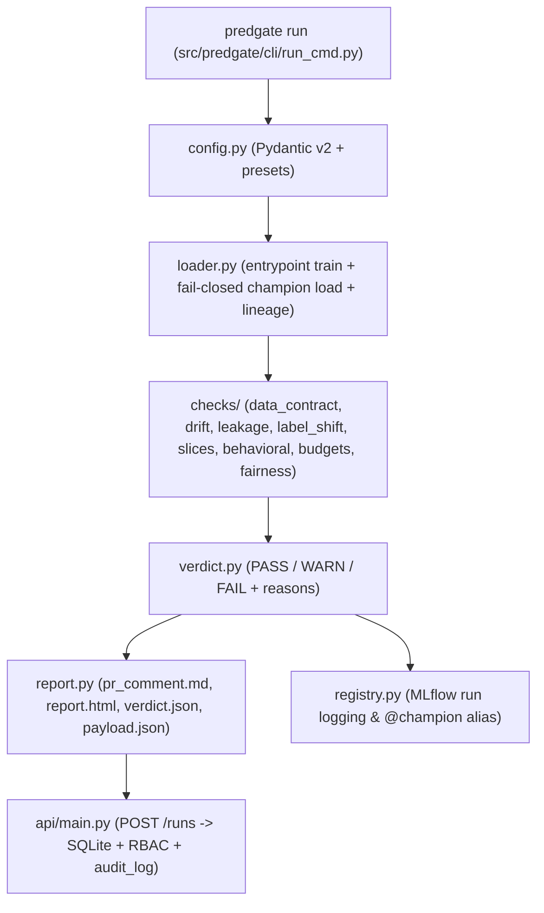

# Architecture

PredGate is structured as a modular Python quality-gate engine (`src/predgate/`), an optional FastAPI persistence and RBAC service (`src/predgate/api/`), and a decoupled React + Vite dashboard (`dashboard/`).

## Execution Data Flow

## Package Layout

- `src/predgate/cli/` — Typer CLI split by command group (`init_cmd.py`, `run_cmd.py`, `lifecycle_cmd.py`, `ops_cmd.py`, `baseline_cmd.py`, `users_cmd.py`, `common.py`).
- `src/predgate/checks/` — The 8 independent check modules (`data_contract.py`, `drift.py`, `leakage.py`, `label_shift.py`, `slices.py`, `behavioral.py`, `budgets.py`, `fairness.py`), each returning a `CheckResult`.
- `src/predgate/stats.py` — Shared statistical primitives (reference-quantile PSI, KS test, vectorized paired bootstrap CI, cell-count multinomial fairness bootstrap, Holm-Bonferroni correction, MDE power calculations).
- `src/predgate/config.py` — Pydantic v2 schema for `predgate.yaml` and `strict` / `balanced` / `quiet` threshold presets.
- `src/predgate/loader.py` & `lineage.py` — Dynamic entrypoint loading, model-family detection, deterministic data/package hashing, and fail-closed champion loading.
- `src/predgate/registry.py` — MLflow run logging, `@champion` promotion, and `champion/` baseline export, import, and SHA-256 verification.
- `src/predgate/verdict.py` & `report.py` — Verdict aggregation and Markdown/HTML/JSON report rendering.
- `src/predgate/bench/` — Synthetic fault-injection suite (`faults.py`, `runner.py`, `render.py`, `render_sections.py`).
- `src/predgate/api/` & `auth.py` — FastAPI REST layer, SQLModel tables, bearer-token hashing, RBAC enforcement, and append-only audit logging.
- `src/predgate/doctor.py` — Environment and configuration preflight checks (`predgate doctor`).
- `dashboard/` — Standalone React + Vite + TypeScript SPA served by Nginx in Docker Compose or locally via `npm run dev`.
- `examples/` — Runnable projects: `examples/credit-risk-demo/` (full 8-check demo with verified champion), `examples/minimal/` (self-contained Diabetes example), and `examples/github-workflow/` (copy-paste CI workflow).

## MLflow Integration

PredGate resolves a single tracking URI (`MLFLOW_TRACKING_URI` environment variable overriding `mlflow.tracking_uri` in `predgate.yaml`, default `sqlite:///mlflow.db`). In Docker Compose, all containers share `MLFLOW_TRACKING_URI=http://mlflow:5000`. During `predgate run`, PredGate passes explicit `pip_requirements` resolved via `importlib.metadata` to avoid MLflow's slow subprocess environment inference.

## Extending PredGate With a New Check

1. Create `src/predgate/checks/<name>.py` returning a `CheckResult`.
2. Add its Pydantic configuration model to `src/predgate/config.py` and wire preset defaults if applicable.
3. Invoke the check in `src/predgate/cli/run_cmd.py`.
4. Add unit tests in `tests/unit/test_checks.py`, document config keys in [Configuration Reference](reference/config.md), and re-run the benchmark if behavior of existing checks changes (`scripts/check_benchmark_fresh.sh`).
