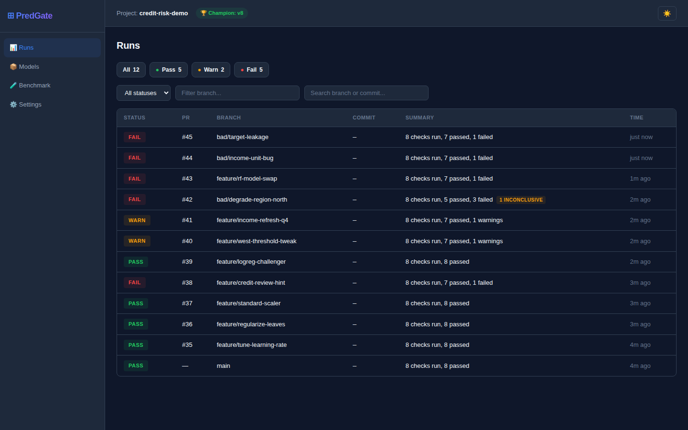
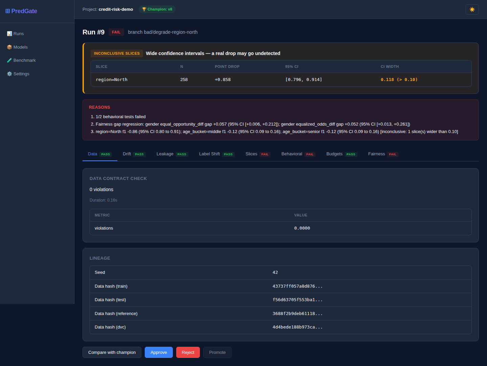
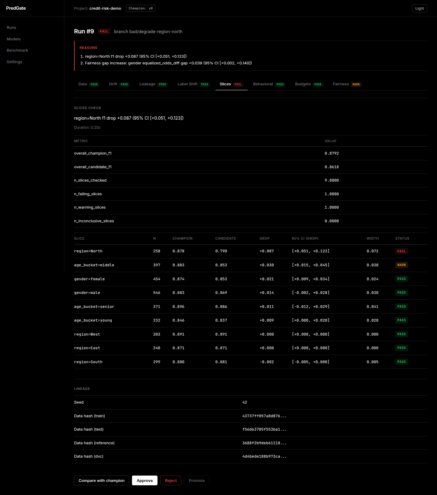
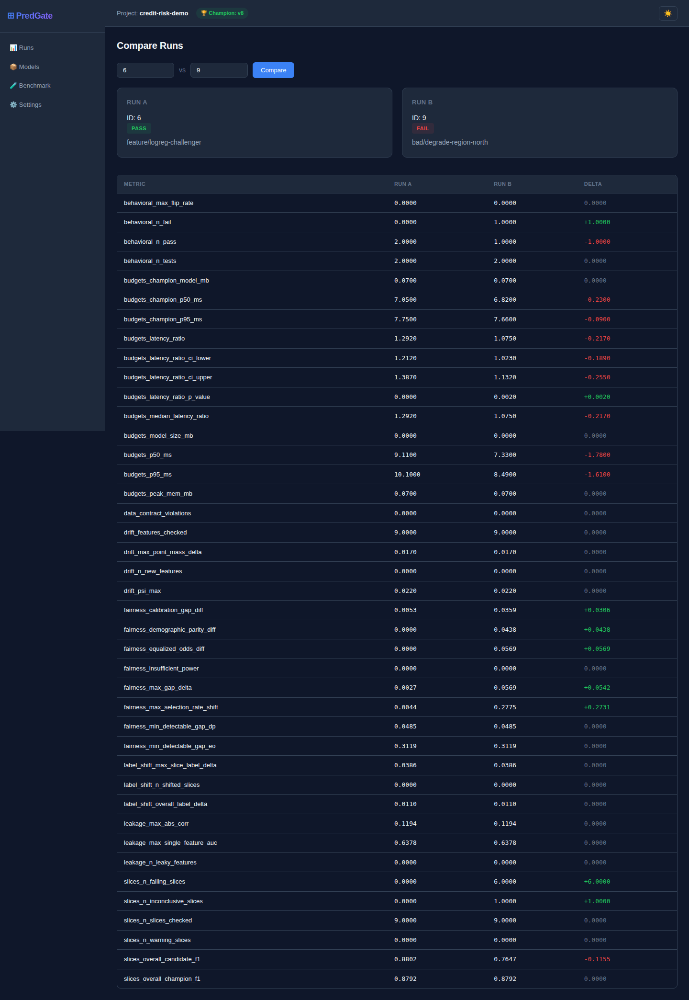
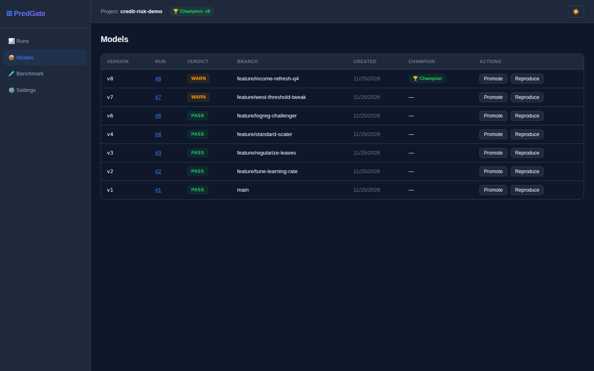

# Web Dashboard Guide

The React + Vite dashboard (`dashboard/`) gives reviewers an interactive interface over the FastAPI backend for inspecting runs, digging into failing or inconclusive slices, comparing runs side-by-side, and approving or promoting models.

!!! note "Wheel vs. Dashboard"
    The React frontend is **not** bundled inside the PyPI wheel (`pip install predgate` includes the CLI and the FastAPI server `predgate serve`). Run the dashboard either with **Docker Compose** (`docker compose up --build` → `http://localhost:3000`) or directly with **Node.js 20+** from a git clone:

    ```bash
    predgate serve --port 8000 &
    cd dashboard && npm ci && npm run dev   # http://localhost:5173
    ```

## Views

### Runs List

Displays all ingested runs with status badges (`PASS`, `WARN`, `FAIL`), branch and PR number, check summaries, and inconclusive-slice counts.



### Run Detail & Reasons

Shows the top-level verdict, reasons list, **Model family changed** callout (when applicable), **Inconclusive Slices** banner, per-check table, approval history, and `Approve` / `Promote` action buttons.



### Slice Explorer

Filter and sort every evaluated slice by metric drop, 95% paired bootstrap CI bounds, sample size (`N`), CI width, and inconclusive status.



### Compare Runs

Side-by-side metric comparison between any two run IDs with computed deltas.



### Models Registry

Lists passing/approved runs and marks the current champion.



## Authenticating in the Dashboard

1. Provision a user token via CLI (`predgate users add <name> --role reviewer|admin`) or set `PREDGATE_ADMIN_TOKEN`.
2. Open the **Settings** tab in the dashboard and paste the bearer token (stored in browser `localStorage` under `predgate_api_token`).
3. Mutating actions enforce RBAC server-side:
   - `reviewer` or `admin` can approve/reject `PASS` and `WARN` runs.
   - `admin` is required to override a `FAIL` run (with a >= 20-character justification) and to promote a run to champion.
