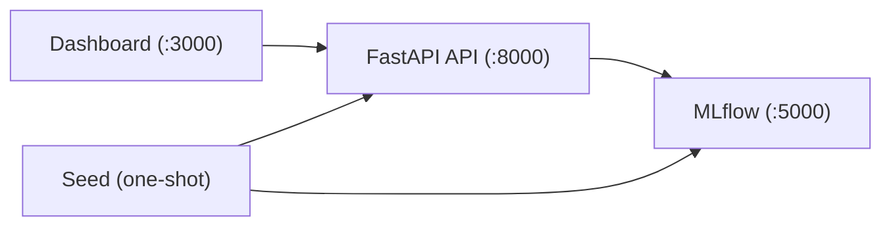

# Docker Compose Stack

PredGate ships a complete Docker Compose environment (`docker-compose.yml`) containing the FastAPI backend, MLflow tracking server, React dashboard, and a one-shot seeding service.

## Start the Stack

```bash
docker compose up --build
```

Services started:

| Service | URL | Purpose |
|---|---|---|
| **Dashboard** | `http://localhost:3000` | React + Vite web UI |
| **API** | `http://localhost:8000` | FastAPI backend (`http://localhost:8000/docs` for Swagger UI) |
| **MLflow** | `http://localhost:5000` | MLflow experiment and `@champion` model registry |
| **Seed** | *(one-shot)* | Runs `scripts/seed.py` once to generate demo data, register `@champion`, provision an ephemeral runner token, and execute 12 real `predgate run` evaluations (`PASS`, `WARN`, and `FAIL`, including PR #42) |

## Architecture & Named Volumes



Persistent named volumes:

- `predgate-data` — mounted at `/app/examples/credit-risk-demo/data`
- `predgate-db` — mounted at `/app/db` (stores SQLite `predgate.db`)
- `mlflow-data` — mounted at `/mlflow` (stores MLflow SQLite backend and model artifacts)

## Provisioning Dashboard Users Inside Docker

PredGate ships with no default admin token. To approve or promote runs from the dashboard UI, provision users inside the running `api` container:

```bash
docker compose exec api predgate users add alice --role reviewer
docker compose exec api predgate users add bob --role admin
```

Copy the printed bearer token and paste it into the dashboard **Settings** page.

## Stopping & Resetting

```bash
docker compose down        # stop containers, keep volumes
docker compose down -v     # stop containers and wipe all seeded data
```
